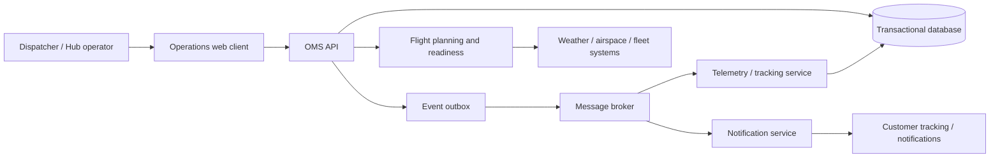

# High-Level Design

## 1. Purpose and scope

Airbound OMS coordinates the operational record for a delivery: an order is created, prepared, assigned to an eligible flight, picked up, tracked in transit, and handed to its recipient. Dispatch staff need one place to see queue health, capacity, and parcel history. The delivered prototype demonstrates the core order, tracking, planning, and assignment loop. This document also describes a credible production target; planned capabilities are not all implemented in this prototype.

### Primary users

- **Dispatcher:** triages requests, selects route-compatible flights, and resolves capacity conflicts.
- **Hub operator:** confirms package custody, scan events, and recipient handoff.
- **Pilot / remote operations operator:** reviews assigned payload and reports flight status.
- **Operations lead:** monitors service levels, failed deliveries, hub backlog, and fleet utilization.
- **Support agent:** answers a recipient's "where is my parcel?" request from a complete timeline.

## 2. Product capabilities

### Implemented prototype

- Create and list delivery orders with recipient, origin, destination, package mass, and priority.
- Enforce a controlled order lifecycle and keep a timestamped event timeline.
- Plan flights with a drone, pilot, route, departure, and payload capacity.
- Assign orders only to matching routes and reject assignments that exceed payload capacity.
- Search and filter the queue; inspect high-level order and flight status from one screen.
- Store data in SQLite, initialize tables and indexes automatically, and expose a health endpoint.

### Candidate product scope

- Ingest orders from partner APIs, ecommerce webhooks, CSV imports, or a customer service console.
- Hub work queues for receiving, weighing, packaging, battery checks, and handoff verification.
- Customer notifications and a privacy-limited public tracking link.
- Flight readiness: battery state, payload envelope, drone maintenance, pilot duty/rest, weather, and airspace constraints.
- Route planning with geofences, landing sites, reserve energy, contingency corridors, and return-to-base plans.
- Live telemetry ingestion, location map, stale-data alarms, geofence breach and lost-link incident workflows.
- Dispatch optimization across time windows, service priority, energy use, payload, and fleet availability.
- Failed delivery / abort, return-to-hub, reschedule, damage, and chain-of-custody workflows.
- Role-based access, audit records, operational reporting, SLA monitoring, and multi-hub configuration.
- Integrations with identity, maps, weather, fleet maintenance, notification providers, and customer systems.

## 3. System context and architecture

The prototype is a single Python WSGI process, a same-origin HTML/JS client, and a SQLite file. That keeps setup small and allows the core workflow to run on one laptop. Production should split clear domain boundaries behind an API while retaining a simple operator client.

**Production boundaries:** OMS owns order intent, assignment, and the business status projection. Flight planning owns the flight plan and readiness decision. The fleet/telemetry adapter owns raw vehicle observations and normalizes them into domain events. Notifications consume durable lifecycle events and never gate a safety action. External systems are integrated through versioned adapters, timeouts, idempotency, and reconciliation.

### Main request flow

1. A partner or operator submits an idempotent order request. OMS validates it and persists the order plus an `OrderCreated` event in one transaction.
2. Hub intake confirms package identity, dimensions, weight, and custody. OMS updates the order and appends an immutable event.
3. Dispatch requests a candidate flight. The readiness service evaluates payload, route, drone, pilot, battery, weather, airspace, and operating windows.
4. Assignment reserves the order and available flight capacity atomically. A unique active assignment prevents double booking.
5. Flight/telemetry events are authenticated, deduplicated, ordered per vehicle where possible, and projected onto the order timeline. Stale or contradictory data raises an operator-visible exception.
6. Recipient handoff requires evidence appropriate to policy (recipient confirmation, code, or hub return). Notification and analytics are asynchronous consumers.

## 4. Domain model and lifecycle

**Order** is the delivery promise and parcel identity. **Parcel event** is an append-only observation of custody or status. **Flight** is a planned or executed mission with a drone, pilot, route, time, and capacity. **Assignment** is a reservation between order and flight. In production, avoid treating a drone's telemetry as authoritative proof of custody or delivery.

Prototype order statuses: `created → planned → picked_up → in_transit → delivered`, with an explicit `failed` terminal outcome available at each active stage. Illegal transitions return conflict. Production should model exceptions and returns as richer sub-states or linked workflows; delivered and failed must remain terminal for the original order record.

## 5. Quality attributes and targets to validate

- **Safety:** OMS informs operations, but flight control and aircraft safety interlocks remain outside this web service. No dispatch without an explicit readiness result in a production build.
- **Correctness:** assignment and capacity reservation are transactional; lifecycle history is append-only; all writes are idempotent or deduplicated.
- **Availability:** initial production target 99.9% monthly for order/dispatch APIs, with defined degraded operation and hub procedures. Flight execution must not depend on OMS availability.
- **Latency:** validate p95 under 300 ms for operator reads and under 500 ms for writes at forecast peak, excluding external providers.
- **Scale:** partition telemetry separately from the transactional order database; retention and query patterns determine partitioning. Prototype SQLite is suitable for local demo only.
- **Security/privacy:** SSO/MFA for staff, least privilege, encryption in transit and at rest, secrets management, PII minimization, access audit, and expiring customer tracking tokens.
- **Observability:** correlate order, flight, and event IDs in logs and traces; alert on backlog, stale telemetry, assignment conflicts, failed handoffs, and provider degradation.
- **Recovery:** define RPO/RTO with operations; backups must be encrypted, monitored, and restore-tested.

## 6. Trust, safety, and data constraints

Recipient names and delivery addresses are personal data. Store only data needed to fulfill the job, restrict staff access, define retention, and redact personal fields from logs and support exports. Validate and normalize inbound identifiers, address text, mass units, timestamps, and event provenance. Keep an auditable record of human overrides. Geofence, weather, battery, aircraft health, and pilot eligibility are safety-critical inputs and require authoritative, current sources plus a fail-closed readiness policy. A prototype route match and payload check is not a substitute for those controls.

## 7. Deployment evolution

Start production as a modular API service with managed relational storage, an outbox-backed event bus, and separately deployable telemetry/notification workers. Run in one region with multi-zone database failover and encrypted backups. Add a second region only after recovery objectives and cross-region consistency are designed. See [production plan](production-plan.md) and the [ADRs](adrs/).
