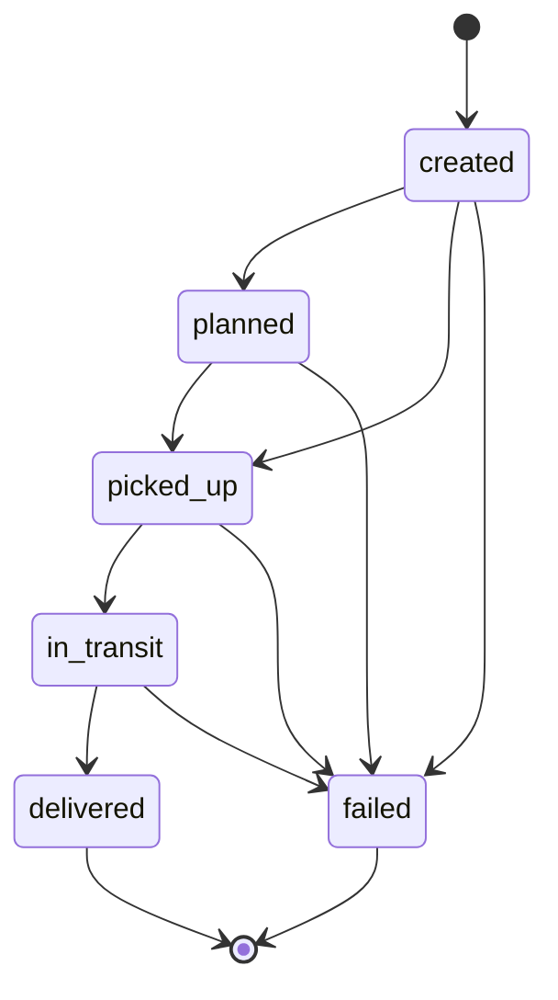

# Low-Level Design

## 1. Prototype component layout

| Path | Responsibility |
| --- | --- |
| `oms.py` | WSGI app, JSON routing/validation, SQLite schema, order/flight workflows, static serving |
| `web/index.html` | Operator dashboard, forms, order table, flight list |
| `web/app.js` | Same-origin API client, rendering, search/filter, form actions |
| `web/styles.css` | Responsive visual design |
| `tests/test_oms.py` | In-process API behavior tests with isolated temporary databases |
| `scripts/profile_list_orders.py` | Reproducible order-list microbenchmark and SQL read count |

The frontend makes same-origin fetches and uses the API as the sole source of state. The WSGI factory accepts a database path so tests can isolate state. `sqlite3` connections are request-scoped, foreign keys are enabled, and indexes support order queue, event timeline, and departure scans. Exceptions are converted into small JSON errors; unexpected exceptions are intentionally generic to avoid exposing internals.

## 2. API conventions

- Base path: `/api`; JSON request/response; UTF-8.
- IDs are integer database IDs in this prototype. Production should expose stable UUID/ULID identifiers.
- Timestamps are ISO 8601 strings. The browser uses `datetime-local` for this demo; production must require and normalize timezone-aware timestamps.
- Writes are transaction-scoped through SQLite's connection context. Validation errors use `400`, missing records `404`, business conflicts `409`, oversized body `413`, and unexpected errors `500`.
- Maximum JSON body is 1 MiB. User-facing string fields have length limits.
- No authentication is implemented. Every API is local/trusted-demo only.

### `GET /api/health`

Returns `200 {"status":"ok"}`. A production readiness probe should also report dependency health separately from liveness.

### `GET /api/orders`

Returns orders ordered newest first. Each list item includes an optional compact `flight` object, `null` when unassigned. The list query joins orders to assignments and flights in one query.

```json
{"items":[{"id":1,"reference":"AB-1042","recipient":"Mira Shah","pickup":"North Hub","dropoff":"North Clinic","package_weight_kg":1.4,"priority":"urgent","status":"created","created_at":"2026-11-17T04:30:00+00:00","updated_at":"2026-11-17T04:30:00+00:00","flight":null}]}
```

### `POST /api/orders`

Request: `reference` (required, max 40), `recipient`, `pickup`, `dropoff` (required strings, max 180), `package_weight_kg` (number, `0 < x <= 25`), `priority` (`standard` or `urgent`, defaults to standard). Returns `201` with the created order. A unique reference conflict is `409`. Creation also adds the initial `created` event at pickup.

### `GET /api/orders/{id}`

Returns the order, optional flight summary, and ordered `events`. Unknown ID is `404`.

### `PATCH /api/orders/{id}/status`

Request: `{"status":"picked_up","location":"North Hub","note":"Seal checked"}`. `status` must be an allowed next transition; `location` and `note` are optional here. On success returns the updated order including its event timeline. Invalid transition is `409`.

### `POST /api/orders/{id}/events`

Request: `status` (valid next status), `location` (required string), `note` (optional, max 500). Returns `201` with the appended event and updates the order's current status. This endpoint is an operator-scan demo; production telemetry must carry source identity, event ID, observed time, received time, and deduplication metadata.

### `GET /api/flights`

Returns flights ordered by departure, including `assigned_order_ids`, `assigned_count`, and `assigned_weight_kg`. One grouped query calculates these summary values.

### `POST /api/flights`

Request: `flight_code`, `drone_id`, `pilot`, `origin`, `destination`, `departure_at` (required non-empty strings), `capacity_kg` (positive number). Returns `201` with the planned flight. Flight code is unique; duplicates return `409`.

### `POST /api/flights/{id}/assign`

Request: `{"order_id":1}`. Requires an existing flight and order, an unassigned order in `created` or `planned` state, exact pickup/origin and dropoff/destination match, and total assigned parcel mass at or below flight capacity. Returns flight summary with assigned IDs. Assignment reserves the order, changes its state to `planned`, and appends an event. Violations return `404`, `400`, or `409`.

## 3. State transitions



The `created → picked_up` shortcut permits a simple demo without a separate preparation/scan step. A production lifecycle should require a validated assignment and explicit custody events before takeoff, while allowing a documented exception workflow.

## 4. SQLite schema

Types below reflect SQLite's dynamic typing and app-level validation. Production PostgreSQL should use explicit numeric precision, timezone-aware timestamps, and enums or constrained text types.

### `orders`

| Column | Definition | Purpose |
| --- | --- | --- |
| `id` | integer primary key | Internal identifier |
| `reference` | text, unique, not null | Human/partner order reference |
| `recipient`, `pickup`, `dropoff` | text, not null | Demo recipient/route information |
| `package_weight_kg` | real, check `0 < x <= 25` | Capacity input |
| `priority` | text, check `standard/urgent` | Dispatch priority |
| `status` | text, not null | Current status projection |
| `created_at`, `updated_at` | text, not null | ISO 8601 timestamps |

Index: `(status, created_at DESC)` supports operational queue filters/order. Unique reference index is created by SQLite.

### `parcel_events`

`id` primary key; `order_id` foreign key with cascade; `status`, `location`, `note`, `occurred_at`. Index `(order_id, occurred_at, id)` supports timeline reads. Events are append-only through API convention; database permissions/triggers should enforce this in a larger service.

### `flights`

`id` primary key; `flight_code` unique; `drone_id`, `pilot`, `origin`, `destination`, `departure_at`, `capacity_kg > 0`, `status`, and `created_at`. Index on `departure_at` supports planning horizon reads.

### `flight_orders`

`flight_id` foreign key, `order_id` foreign key, composite primary key `(flight_id, order_id)`, and unique `order_id` to prevent an order from being active on multiple flights. The schema currently does not retain assignment history after reassignment/cancellation; production should model assignment records with state and timestamps.

## 5. Production schema extensions

Introduce tenant/hub IDs; stable public IDs; address/geospatial IDs rather than free-text equality; package dimensions and hazard classification; delivery windows and consent/preferences; assignment state/history; drone and pilot references; readiness checks with versioned evidence; append-only domain event provenance; idempotency keys; optimistic version; audit actor; and soft deletion/retention fields. Use Postgres constraints and a transaction/locking strategy for capacity reservation. Store high-volume raw telemetry in a time-series/event store with retention and a summarized pointer from the order timeline.

## 6. UI behavior

The page fetches orders and flights in parallel at startup. Operator actions submit JSON, then refresh from the API. Search matches reference, recipient, and route text; priority filtering is client-side. An order advance button sends the next legal lifecycle status and an operator note. The assignment form offers unassigned eligible orders; backend validation remains authoritative. Dynamic text is HTML-escaped before insertion. The form gives only success/error notices and does not claim live aircraft telemetry.

## 7. Error handling and concurrency

The prototype relies on SQLite transactions and uniqueness constraints but does not implement API idempotency, pagination, optimistic versions, or a capacity reservation lock protocol for concurrent writers. Production assignment should lock the flight/assignment aggregate (or use a serializable transaction with retry) and atomically verify active weight before reserve. Add `Idempotency-Key` for partner writes, page all potentially large collections, and return a stable error code plus trace ID.
